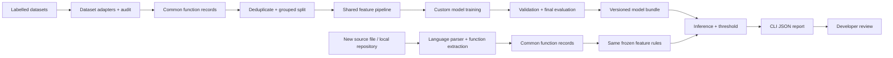
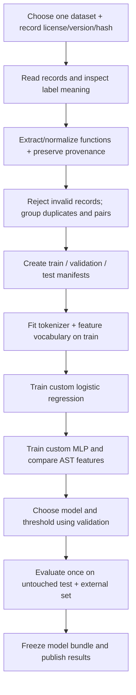
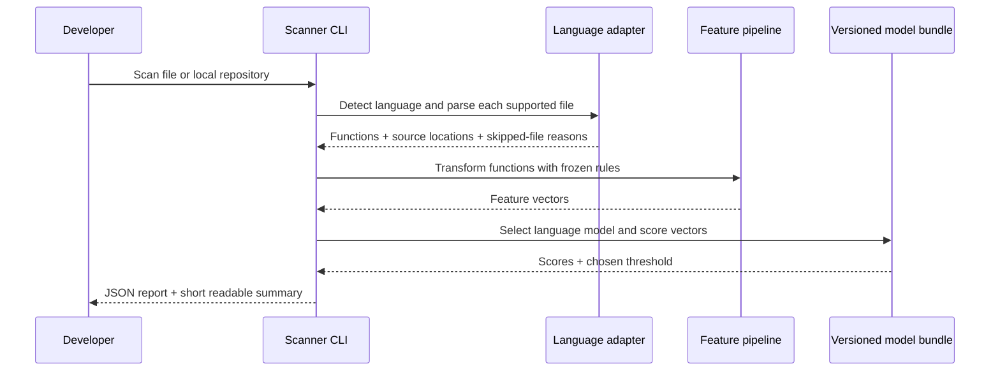
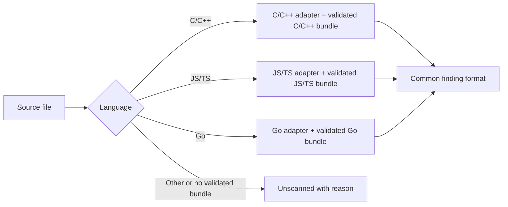

# VulnScope architecture: from source code to a review finding

**Status:** Proposed design for review, 2026-10-13. This explains how we intend to build the system; no component described here has been implemented yet. It follows the [idea](idea.md), [phase roadmap](phases.md), [resource inventory](resources.md), and [ML methodology](ml-methodology.md).

## 1. What we are building

VulnScope will learn from labelled **functions**, then scan new source files or a local repository and flag functions worth a security review. For each supported function, the first version returns a model score, a flagged/not-flagged decision, the file and function location, and the model version. It does **not** prove that a vulnerability exists or that an unflagged function is safe.

The first full path is C/C++. JS/TS and Go are added only after their data is audited and each language has its own measured model. The first training task uses binary dataset labels (`vulnerable` / `non-vulnerable or fixed`); the scanner presents the result as `flagged` / `not flagged`. CWE prediction and suspicious-line ranking need separate evidence and come later.

### One-picture view



There are two paths: **offline training**, which can take time and uses labelled data, and **scanning**, which loads an already trained bundle. The parser and feature definitions must match between the paths. A scan never trains a model.

## 2. Main building blocks

| Block | What it does | Input → output |
|---|---|---|
| Dataset adapter | Reads one dataset's format and label rules; records source and license provenance | Raw source record → common labelled function record or rejection reason |
| Language adapter | Detects a supported language, parses files, extracts functions and source positions | Source file → function records and parse diagnostics |
| Data quality and split | Checks labels, removes/groups duplicates and related versions, assigns train/validation/test | Labelled records → fixed split manifests |
| Feature pipeline | Creates lexical features first, then AST features; fits vocabulary/statistics on train only | Function record → fixed-length feature vector |
| Custom models | Our NumPy logistic regression and MLP; optional ensemble after individual results | Feature vector → model score |
| Evaluation | Compares predictions with held-out labels and records errors | Scores + labels → metrics and examples |
| Model bundle | Saves parameters, feature rules, threshold, language, and provenance together | Training result → loadable versioned artifact |
| Scanner/reporting | Traverses input, routes by language, scores functions, reports findings and skipped files | File/repository → JSON report and readable CLI summary |

**Boundary rule:** each dataset adapter knows its dataset schema; each language adapter knows syntax; neither decides the vulnerability result. The model sees feature vectors, not parser objects or raw advisory records. The scanner uses the same feature pipeline and model bundle selected during evaluation.

## 3. The common record: how parts connect

Every parser or dataset adapter produces a common **function record** containing at least:

- `language`, `file_path`, `function_name` when available, `start_line`, `end_line`, and `source_code`;
- `source_id`, `repository`, `commit`, `dataset_version`, and license/provenance fields when the record comes from training data;
- `label` only for verified labelled examples (`1` or `0`); an ordinary scanned function has **no label**;
- `group_id` linking near duplicates, generated variants, and vulnerable/fixed versions that must remain in the same split;
- parse status and reason if the function could not be extracted reliably.

Labels are source-specific claims. A missing label is never converted to `0`. A dataset may supply code that has already been extracted into functions; its adapter still has to verify the label and location fields. A repository scan extracts functions directly from files. Both paths then enter the same feature interface.

### Why the group ID matters

If the vulnerable and fixed versions of a function land on opposite sides of train/test, the test becomes artificially easy. We group related samples before splitting, record split membership in a manifest, and fit the vocabulary **after** the split using training records only. The default target is about 70% training, 15% validation, and 15% test, but groups and class coverage take priority over exact ratios. Validation chooses model settings and threshold. The test set is opened only for final measurement. Full rules are in [ML methodology](ml-methodology.md).

## 4. Training path, step by step



1. **Audit a source.** Check access, rights, schema, counts, balance, label meaning, and sample quality before treating it as training data. Juliet is the first C/C++ candidate; real-world data is valuable for a separate transfer check.
2. **Prepare reproducible records.** Preserve raw data unchanged, record rejected cases, and save exact split IDs. Do not mix datasets until their labels are compatible.
3. **Build features.** Start with a capped training-only token vocabulary and selected lexical/size signals. Then add AST counts, nesting, calls, and structural patterns. Exclude file paths, source IDs, CWE fields, and dataset naming cues from model inputs. Keep the feature specification and fitted vocabulary in the bundle.
4. **Train our models.** Implement logistic regression with explicit sigmoid, loss, gradients, and updates. Then implement a small MLP with forward pass, backpropagation, minibatches, L2 regularization, validation-based early stopping, and checkpoints. Compare unweighted training with train-derived class weighting if positives are scarce. NumPy supplies array operations; it does not supply the classifier.
5. **Compare fairly.** Use the same splits and natural class prevalence in validation/test for lexical/AST and logistic/MLP experiments. Try soft voting after individual models work. Try stacking only with out-of-fold base predictions. Keep the simplest model that performs credibly on untouched data.
6. **Freeze and evaluate.** Choose a threshold on validation data, run final test and repository-held-out/external evaluation, save metrics and error examples, and version the chosen bundle.

We will report precision, recall, F1, average precision/PR-AUC, ROC-AUC, confusion matrix, class prevalence, false-positive/false-negative rates, and scan latency where applicable. A raw model score is labelled a **score**; it becomes a probability estimate only after calibration is measured. The operating threshold is selected from validation data before the final test.

## 5. Scanning path, step by step



The scanner reads files, but does not execute the target repository. It skips unsupported, unreadable, oversized, or unparseable files with an explicit reason and count. It must never report a skipped file as safe. Findings initially point to **functions**, not exact vulnerable lines. A finding contains a score, threshold decision, model version, language, path, function span, and a reminder that a developer must review it. The report also lists scan coverage and failures so users know what was actually examined.

**Example report meaning:** `file: src/auth.c`, `function: check_token`, `lines: 21–49`, `score: 0.78`, `threshold: 0.70`, `flagged: true`. This means the model ranked that function above the chosen review threshold; it does not establish a CWE or identify the exact bug line.

## 6. The versioned model bundle

A deployable bundle contains the model parameters plus everything needed to reproduce its input and decision:

```text
model bundle
├── manifest: model ID/version, language, training run, data/split hashes
├── feature specification: tokenizer/AST settings, vocabulary, feature order
├── parameters: weights and biases for the selected custom model
├── decision policy: validated threshold; calibration data if supported
└── compatibility: parser/grammar and code format versions
```

Loading rejects missing or incompatible pieces instead of silently using different feature order. The bundle is produced by training and only **read** by scanning. Raw datasets and large model artifacts stay outside Git unless a deliberate artifact policy is chosen; small manifests and experiment reports can be versioned in Git.

## 7. Language expansion without confusing results



Language adapters share a common record/report contract, but their parser rules, feature vocabularies, model parameters, thresholds, and metrics may differ. C and C++ receive separate reported metrics even if a combined model is evaluated. JS and TS begin with separate baselines; a combined model is an experiment. Go advisories are leads for locating patches, not function labels by themselves. If a language lacks a defensible dataset or validated model, it stays unsupported in the scanner.

## 8. Code and data layout we expect

This is a responsibility map for implementation planning, not a scaffold that already exists:

```text
docs/                 idea, phases, resources, architecture, audits, results
configs/              pinned dataset and experiment settings
src/data/             dataset adapters, validation, deduplication, splits
src/languages/        language detection, parsers, function extraction
src/features/         lexical and AST features, frozen transforms
src/models/           custom logistic regression, MLP, ensemble
src/training/         training runs, checkpoints, bundle creation
src/evaluation/       metrics, comparisons, error analysis
src/inference/        bundle loading, model routing, scan/report policy
src/cli/              command-line input and output
tests/                small fixtures and behavior checks
data/                 raw and processed datasets; ignored by Git
artifacts/            trained bundles and large outputs; ignored by Git
experiments/          reproducible run manifests and result summaries
```

An optional FastAPI endpoint can call the **same inference service** as the CLI after the local scanner works. A web UI, database, Docker image, and GitHub integration are delivery additions, not prerequisites for proving the model.

## 9. Design choices and trade-offs

| Approach | Benefit | Cost / decision |
|---|---|---|
| **Chosen: shared pipeline, language-specific adapters and validated bundles** | One training/inference contract and honest per-language results | More than one model artifact to manage |
| One model for all languages from day one | A single artifact | Data and syntax differ; early cross-language claims would be hard to justify |
| Separate complete system for each language | Full freedom to specialize | Duplicates splitting, metrics, CLI, and artifact logic |

For the first milestone, a CPU-friendly NumPy baseline and CLI keep the research inspectable and runnable on the available machine. We will add complexity only when a measured result or a product need supports it.

## 10. How we know each part works

| Layer | Evidence before moving on |
|---|---|
| Dataset | License/version/hash recorded; labels sampled manually; retained/rejected counts reported |
| Split | Duplicate families, repositories, and vulnerable/fixed pairs respect the split policy |
| Features | Hand-written examples produce expected tokens/AST counts; inference uses the frozen training vocabulary |
| Models | Loss/gradient tests and numerical gradient checks; saved model reloads to the same scores |
| Evaluation | Metrics checked on small known examples; validation and test roles remain separate; external/repository-held-out results reported |
| Scanner | Known sample scan returns stable locations and versioned scores; failures and unsupported files appear in coverage summary |

## 11. Build order from start to finish

The [phase roadmap](phases.md) contains the exit criteria. In short: **project foundation → dataset audit → reproducible data and split → logistic baseline → AST/MLP comparison → generalization/ensemble decision → first CLI scanner → JS/TS → Go → final report and demo**. The first model milestone is a C/C++ dataset pipeline and custom logistic baseline; the first user-facing milestone is a C/C++ CLI scanner backed by a frozen, evaluated model.

## 12. Decisions for this design review

- Use C/C++ as the first language unless the Phase 1 audit shows its candidate data is unsuitable.
- Use a common function record and shared training/inference feature contract.
- Keep model bundles and evaluation separate by language until cross-language experiments justify sharing.
- Ship a local CLI and JSON report first. Add an API only after that path is stable.
- Report function spans and model scores initially; CWE and exact-line claims remain gated extensions.

Once this architecture is agreed, the next task is a small Phase 0 implementation plan. Dataset-specific details stay open until the Phase 1 audit gives evidence for them.
