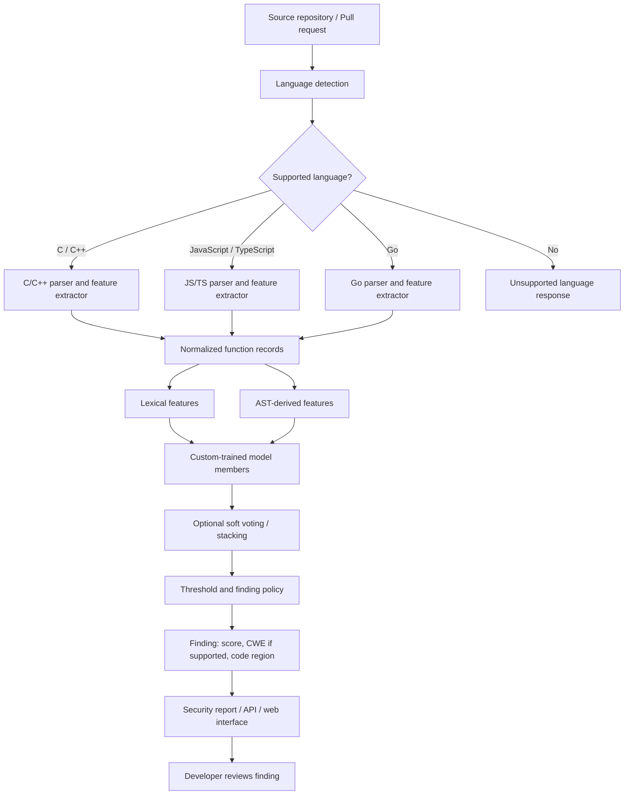
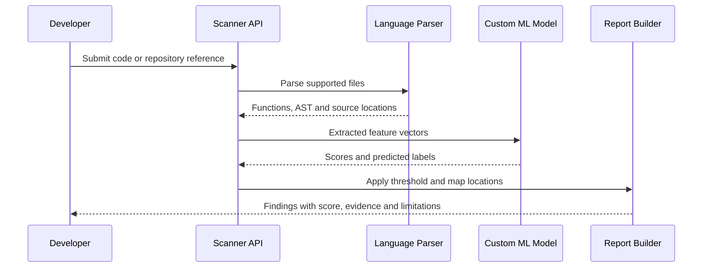
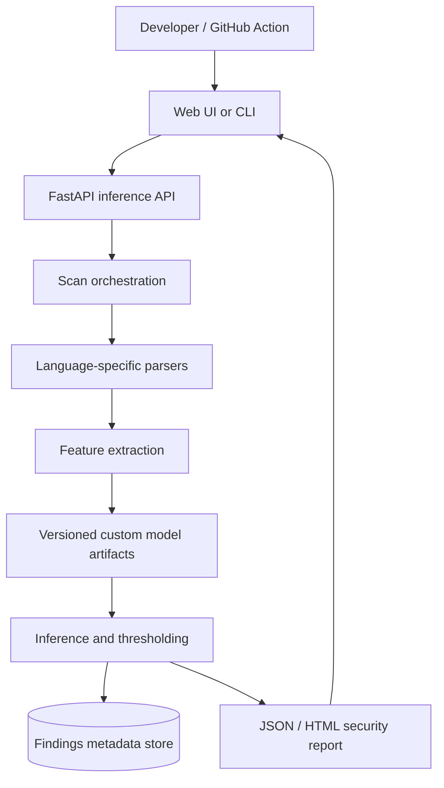

# ML-Powered Source Code Vulnerability Detection

> **Project type:** Applied Machine Learning + Program Analysis + Application Security  
> **Working title:** VulnScope — a custom-trained, multi-language vulnerability detection and localization system  
> **Initial language scope:** C/C++, JavaScript/TypeScript, and Go  
> **Core requirement:** Implement and train our own ML models. Do not use ready-made classifier packages as the core model.

---

## 1. Project overview

VulnScope is a machine-learning-powered static application security testing (SAST) prototype. It analyzes source code, predicts whether a function or code region may contain a security vulnerability, estimates the likely weakness category where labels support it, and highlights suspicious lines or regions for developer review.

The central research goal is not merely to connect an API to an LLM. The project will build a reproducible dataset pipeline, implement model-training logic, compare different source-code representations, experiment with an ensemble, and test whether the model generalizes to repositories it has not seen during training.

The first version targets three language families:

- **C/C++** — established benchmark datasets and memory-safety weaknesses.
- **JavaScript/TypeScript** — practical relevance to modern web and Node.js development.
- **Go** — server-side services, package ecosystems, and concurrency-related security concerns.

The languages will be added in stages. We will not assume that one model trained on one language automatically works for another. Dataset availability, label quality, parser support, and evaluation results will determine when each language is enabled.

## 2. Problem statement

Security vulnerabilities can be difficult to identify during code review, particularly in large repositories and pull requests. Conventional static-analysis tools rely heavily on manually designed rules, symbolic reasoning, or known vulnerability patterns. These techniques are valuable, but they may produce false positives, miss patterns outside their rules, or require significant configuration.

This project investigates whether a custom-trained ML model can learn useful vulnerability signals from source code and program structure, then assist a developer by providing:

1. A vulnerability-risk prediction for a function or code region.
2. A confidence/probability score, calibrated and interpreted carefully.
3. A predicted CWE category when supported by training data.
4. A ranked list of suspicious lines or code regions, if localization experiments are successful.
5. A report that explains the model's evidence and limitations.
6. A deployable API and repository-scanning interface.

**The system is a developer-assistance tool, not a proof of vulnerability or a replacement for security review.** A positive prediction is a lead to investigate, and a negative prediction does not prove that code is safe.

## 3. Research questions

- **RQ1:** How well can custom-trained models distinguish vulnerable from non-vulnerable code?
- **RQ2:** Do lexical features, AST-derived features, and control/data-flow features provide complementary signals?
- **RQ3:** Does a soft-voting or stacking ensemble outperform the strongest individual model on a held-out test set?
- **RQ4:** How much performance changes when evaluation uses unseen repositories or a later time period?
- **RQ5:** Can the model rank suspicious lines or regions usefully, rather than only label an entire function?
- **RQ6:** How transferable are the methods across C/C++, JavaScript/TypeScript, and Go when each language has its own data and parser?

These questions will be answered using measured experiments, not assumed outcomes.

## 4. Scope and staged language plan

### Stage 0 — Dataset and feasibility audit

Before committing to a language, inspect dataset licenses, sample counts, label definitions, duplicate rates, class balance, and parser compatibility. Build a small data report for each candidate language.

### Stage 1 — First end-to-end baseline

Start with **one language and one dataset** to validate the full pipeline. The initial default is C/C++ because Juliet provides a well-known labelled benchmark and Big-Vul provides real-world vulnerability examples. If early feasibility checks show that the JavaScript/TypeScript dataset is better suited to the intended product, the order may be changed without changing the overall architecture.

### Stage 2 — JavaScript/TypeScript

Add language-aware tokenization and AST extraction. Use function-level vulnerable/fixed examples where available. Evaluate JavaScript and TypeScript separately as well as together, and check whether TypeScript type information improves results.

### Stage 3 — Go

Use labelled Go code where available and construct carefully documented examples from public advisories, patches, and repository history. The official Go vulnerability database is useful for advisory and package metadata, but **it is not itself a ready-made function-level binary-labelled ML dataset**. Each sample's label must be derived and validated carefully.

### Stage 4 — Multi-language evaluation

Only after language-specific baselines are reliable should we investigate shared representations or cross-language transfer. The first production prototype may use separate models per language behind one API.

## 5. Dataset sources

These are starting points, not a claim that every source is immediately ready to merge. Verify the current download, schema, license, and terms before using a source. Record source version, retrieval date, hashes, and any preprocessing.

### 5.1 C/C++

| Source | What it provides | Intended use | Link |
|---|---|---|---|
| NIST Juliet C/C++ 1.3 | Synthetic, structured test cases organized by CWE; the official page lists 64,099 cases across 118 CWEs | First controlled benchmark; validate parser and labels | https://samate.nist.gov/SARD/test-suites/112 |
| NIST SARD | Broader Software Assurance Reference Dataset with multiple suites and weakness categories | Additional controlled test suites and later language expansion | https://samate.nist.gov/SARD |
| Big-Vul | Real-world C/C++ vulnerability examples linked to CVEs/commits and vulnerable/fixed code | Real-world training or, preferably, a distinct external evaluation | https://github.com/nqaisme/big-vul-dataset |
| Devign / CodeXGLUE | Real-code vulnerability-detection benchmark | Compare against a published benchmark; keep split definitions clear | https://github.com/microsoft/CodeXGLUE |

Important: Juliet is synthetic. High performance on Juliet alone does not demonstrate that the model will detect vulnerabilities in unfamiliar production code. Big-Vul and Devign have their own data-quality, labelling, duplication, and split concerns.

### 5.2 JavaScript / TypeScript

| Source | What it provides | Intended use | Link |
|---|---|---|---|
| JsVul | Function-level vulnerable/fixed JavaScript and TypeScript dataset and curation pipeline, assembled from multiple sources with deduplication and temporal splits | Main candidate for JS/TS experiments | https://github.com/jsvul/jsvul |
| JsVul dataset on Zenodo | Dataset release associated with the JsVul project | Download a fixed release for reproducibility | https://doi.org/10.5281/zenodo.18195838 |
| SecBench.JS | JavaScript security benchmark cases covering categories such as code/command injection, path traversal, prototype pollution, and ReDoS | Targeted evaluation and supplementary examples; check labels and licensing | https://github.com/cristianstaicu/SecBench.js |
| NVD | Public CVE records and references; generally not source-code samples by themselves | Metadata enrichment and linking vulnerabilities to fixes | https://nvd.nist.gov/ |

JsVul combines sources and has a documented acquisition/curation workflow. Prefer its published dataset release for reproducible initial experiments rather than immediately attempting to recreate every upstream source.

### 5.3 Go

| Source | What it provides | Intended use | Link |
|---|---|---|---|
| Official Go Vulnerability Database | Go ecosystem vulnerability records in OSV format, including affected packages and references | Advisory metadata, package/version information, and locating fixes | https://go.dev/doc/security/vuln/database |
| Bulk Go vulnerability database | Official downloadable archive of vulnerability records | Reproducible metadata ingestion | https://vuln.go.dev/vulndb.zip |
| OSV | Open vulnerability schema and ecosystem vulnerability records | Cross-source identifier matching and metadata normalization | https://osv.dev/ |
| GitHub Advisory Database | Advisories with package/ecosystem metadata and references | Find Go advisories and related patches; source code must be collected separately | https://github.com/advisories |

Go requires extra dataset engineering. An advisory record does not automatically tell us which exact function is vulnerable or whether every function in an affected repository should be labelled vulnerable. Link advisories to commits and code changes where possible, preserve provenance, and manually audit a sample.

### Dataset policy

- Do not combine datasets until their label semantics are understood.
- Keep source, repository, commit, CVE/CWE, and license metadata with every example.
- Deduplicate exact and near-duplicate functions before splitting.
- Keep vulnerable/fixed pairs and related versions in the same split unless the experiment explicitly tests temporal generalization.
- Never use a test set to tune model architecture, weights, or thresholds.
- Report the actual retained sample counts after cleaning; do not repeat headline dataset sizes as if every record were usable.

## 6. Labels and prediction tasks

The first task is binary function-level classification:

- `1 = vulnerable` according to the source's documented label.
- `0 = non-vulnerable/fixed` according to the source's documented label.

The meaning of a negative label varies by dataset. A function marked non-vulnerable is not guaranteed to be secure in every context. Preserve source-specific label definitions and do not silently treat missing labels as safe.

Optional later tasks:

1. **CWE classification:** multi-class or multi-label prediction for supported CWE categories.
2. **Line/region ranking:** rank code lines or spans associated with a vulnerability/fix.
3. **Patch-aware analysis:** compare vulnerable and fixed functions.
4. **Repository-level reporting:** aggregate function-level results while controlling duplicate findings.

Start with binary classification. CWE classification and localization are extensions, not prerequisites for the first valid model.

## 7. Core ML requirement: implement our own model

### Non-negotiable project rule

**The core classifiers and training algorithms must be implemented by us.** We must be able to explain and inspect the forward pass, loss function, gradients or parameter updates, optimization loop, prediction logic, and evaluation code.

Do not use ready-made classifier implementations such as `sklearn` LogisticRegression, `RandomForestClassifier`, `SVC`, `XGBClassifier`, `LGBMClassifier`, or `CatBoostClassifier` as the project's claimed custom model. They can be used only as optional reference baselines if clearly separated from our own results and allowed by the project requirements.

Allowed support tools include language parsers, data-handling utilities, numerical array libraries, plotting libraries, and experiment-tracking tools. Parser output is input data; it is not the vulnerability detector.

### Recommended custom model progression

#### Model A — Custom logistic regression

Implement with NumPy:

- token/feature matrix input;
- sigmoid probability function;
- binary cross-entropy loss;
- analytical gradient calculation;
- gradient descent or mini-batch gradient descent;
- optional L1/L2 regularization;
- prediction threshold;
- save/load learned parameters.

This creates a transparent baseline and proves that the training pipeline is genuinely ours.

#### Model B — Custom shallow neural network

Implement a small multilayer perceptron using NumPy:

- embedding or numeric feature input;
- linear layers and activation functions;
- forward pass;
- binary cross-entropy;
- backpropagation;
- SGD or Adam implemented explicitly;
- minibatches, validation monitoring, early stopping, and checkpointing.

Autograd-based frameworks may be explored later, but the initial educational/core version should make the training mechanics visible.

#### Model C — Custom tree learner (optional advanced phase)

If time allows, implement a small decision tree using Gini impurity or entropy and then a random forest using bootstrap samples and feature subsampling. Document computational limits. A custom tree implementation is not necessary for the first milestone.

#### Model D — AST/structural model

Start with AST-derived numeric features and train the custom logistic regression/MLP. Later, explore a graph model only if we have a defensible graph representation, enough data, and time to evaluate it.

Do not claim to have implemented a graph neural network merely because an AST parser is used.

### What may use existing packages?

- **Allowed:** NumPy for arrays and numerical operations; pandas or equivalent for data preparation; Clang/tree-sitter/TypeScript compiler parser/Go parser for syntax extraction; FastAPI for serving; pytest for tests.
- **Optional comparison only:** scikit-learn or established boosting packages, with results clearly labelled as external baselines.
- **Not the core model:** pretrained CodeBERT/GraphCodeBERT or an API that delegates detection to an LLM.
- **LLM role, if added:** optional explanation drafting from verified model output. It must not replace the trained detector, and its prose must not be presented as ground truth.

## 8. Input representations

We will compare increasingly structural representations rather than immediately attempting a large model.

### A. Lexical features

- token counts and token n-grams;
- identifier/operator/API patterns;
- calls to sensitive operations;
- code length and basic complexity indicators;
- language-specific tokens.

A custom tokenizer/normalizer should preserve security-relevant distinctions. Avoid aggressive normalization that erases types, constants, API names, or source/sink patterns.

### B. AST-derived features

Use a language-appropriate parser to obtain syntax trees. Convert them into explicit features such as:

- node-type counts and depths;
- call-expression and assignment patterns;
- nesting and branch counts;
- selected parent-child patterns;
- function parameters, returns, and relevant API calls.

The parser can be an existing tool; the feature design and ML training are our work.

### C. Optional control-flow/data-flow features

For later research, extract control-flow or approximate data-flow features where reliable tooling exists. Different languages require different analysis capabilities. Treat this as an advanced stage, not a promise for the first version.

## 9. Ensemble experiments

An ensemble is an experiment, not an assumed improvement. First establish that the individual models are reliable.

### Candidate members

- Model A: custom logistic regression over lexical features.
- Model B: custom MLP over lexical features.
- Model C: custom MLP over AST-derived features.
- Later: custom tree/forest or another independently trained model.

### Soft voting

If each member estimates a positive-class probability, combine them:

\[
p_{\mathrm{ensemble}}(x)=\sum_{i=1}^{m}w_i p_i(x),
\qquad \sum_{i=1}^{m}w_i=1
\]

Begin with equal weights. If weights are tuned, use validation data only. Check probability calibration before interpreting the result as a real-world risk probability.

### Stacking

Train a small custom meta-classifier on **out-of-fold predictions** from the base models. Do not train the meta-model on in-sample predictions from models that already saw those examples; that causes leakage and overoptimistic results.

### Required comparison

Compare every individual model against:

1. Equal-weight soft voting.
2. Validation-tuned soft voting.
3. Stacking, if enough data is available.

Keep the ensemble only if it improves a meaningful metric or provides a justified operational trade-off on the untouched test set. An ensemble may be worse than the best individual model, and that result must be reported honestly.

## 10. Data preparation and leakage prevention

A rigorous split strategy matters as much as model architecture.

1. Ingest and validate source records.
2. Normalize source metadata without destroying relevant code semantics.
3. Remove exact duplicates and detect near duplicates.
4. Keep repository, commit, vulnerable/fixed pair, and related generated variants grouped.
5. Create training, validation, and test partitions before any data-driven preprocessing or resampling.
6. Fit vocabularies, feature transforms, and any learned preprocessing on training data only.
7. Use validation data for architecture/threshold/ensemble decisions.
8. Keep the test set untouched until the experiment is finalized.
9. Add repository-aware evaluation and, where possible, a time-based or external-dataset evaluation.
10. Document how uncertain labels, generated examples, and source-specific biases are handled.

**Do not randomly split nearly identical vulnerable/fixed variants across train and test.** The model may memorize templates instead of learning transferable vulnerability signals.

## 11. Evaluation plan

Report more than accuracy.

- Precision
- Recall
- F1-score
- PR-AUC
- ROC-AUC
- Confusion matrix
- False-positive rate
- False-negative rate
- Inference latency and throughput
- Per-language and per-CWE performance where sample sizes permit
- Repository-aware / temporal generalization
- Calibration metrics, if probabilities are presented to users

For a developer-facing SAST tool, false positives matter because noisy findings reduce trust. False negatives matter because missed vulnerabilities create a false sense of security. Select operating thresholds using validation data and explain the trade-off.

Compare:

- custom logistic regression baseline;
- custom MLP baseline;
- lexical versus AST features;
- each individual model versus the ensemble;
- in-distribution versus repository-held-out performance;
- C/C++, JS/TS, and Go separately.

Do not promise a particular accuracy in advance.

## 12. System architecture



### Training architecture

```mermaid
flowchart LR
    A[Dataset sources] --> B[Dataset audit and provenance]
    B --> C[Deduplication and grouped split]
    C --> D[Tokenizer and parser]
    D --> E[Feature extraction]
    E --> F[Custom training loop]
    F --> G[Validation and tuning]
    G --> H[Freeze model and threshold]
    H --> I[Untouched test evaluation]
    I --> J[Model artifact and report]
    J --> K[Inference service]
```



### Inference flow



## 13. Product features

### MVP

- Upload a source file or submit a repository/commit.
- Detect supported language.
- Parse code and extract functions.
- Run the custom-trained model.
- Display vulnerable/not-flagged predictions with scores.
- Show source file and function location.
- Export a JSON report.
- Clearly state that the detector is experimental and can miss vulnerabilities.

### Later additions

- GitHub pull-request integration.
- CWE predictions for well-supported categories.
- Line/region ranking.
- Comparison of original and patched functions.
- Per-language model registry and versioning.
- False-positive feedback and reviewed examples.
- Experiment dashboard with model comparisons.
- Optional LLM-generated plain-English explanation grounded in model findings.

Do not use the model's feature attribution alone to claim a causal explanation. If explanations are added, distinguish measured model signals from verified vulnerability evidence.

## 14. Deployment architecture



Possible stack:

- **Model and training:** Python + NumPy initially.
- **Parsing:** Clang tooling for C/C++, TypeScript compiler API or tree-sitter for JS/TS, Go parser tooling for Go.
- **API:** FastAPI.
- **Frontend:** React/Next.js, or start with a CLI and a simple report.
- **Persistence:** SQLite for MVP; PostgreSQL if multi-user/history features are required.
- **Packaging:** Docker.
- **CI integration:** GitHub Actions after local inference is stable.

The deployed service should load a versioned model artifact and run inference. It should not retrain on every request. Training is a separate reproducible pipeline.

## 15. Suggested repository structure

```text
vulnscope/
├── README.md
├── idea.md
├── docs/
│   ├── dataset-audit.md
│   ├── experiment-plan.md
│   └── threat-model.md
├── data/
│   ├── raw/                 # ignored by Git
│   ├── interim/             # ignored by Git
│   └── processed/           # ignored by Git
├── configs/
│   ├── c_cpp.yaml
│   ├── javascript_typescript.yaml
│   └── go.yaml
├── src/
│   ├── data/
│   │   ├── ingest.py
│   │   ├── validate.py
│   │   ├── deduplicate.py
│   │   └── split.py
│   ├── languages/
│   │   ├── c_cpp/
│   │   ├── javascript_typescript/
│   │   └── go/
│   ├── features/
│   │   ├── tokenizer.py
│   │   ├── lexical.py
│   │   └── ast_features.py
│   ├── models/
│   │   ├── logistic_regression.py
│   │   ├── mlp.py
│   │   ├── tree.py              # optional
│   │   └── ensemble.py
│   ├── training/
│   │   ├── losses.py
│   │   ├── optimizers.py
│   │   ├── train.py
│   │   └── checkpoints.py
│   ├── evaluation/
│   │   ├── metrics.py
│   │   ├── calibration.py
│   │   └── reports.py
│   ├── inference/
│   │   └── predictor.py
│   └── api/
│       └── main.py
├── tests/
├── experiments/
│   ├── configs/
│   └── results/
├── models/                  # versioned artifacts; large files managed separately
└── deployment/
    └── Dockerfile
```

The exact structure can change as the implementation evolves. Raw datasets, secrets, and large model files should not be committed to Git.

## 16. Milestones

### Milestone 1 — Dataset audit

- Download one primary dataset and record its license/version.
- Inspect schemas, label semantics, class balance, language, and file formats.
- Measure exact duplicates and near duplicates.
- Produce a data-quality report.
- **Exit condition:** we know what the labels mean and can reproduce the cleaned dataset.

### Milestone 2 — Data pipeline

- Extract functions and source locations.
- Build the first tokenizer and feature matrix.
- Create grouped train/validation/test splits.
- Write tests for parsing failures and label handling.
- **Exit condition:** data preparation is repeatable and leakage-aware.

### Milestone 3 — First custom model

- Implement logistic regression using NumPy.
- Implement loss, gradient, optimization loop, prediction, and save/load.
- Compare training and validation curves.
- **Exit condition:** the model trains from our own code and results can be reproduced.

### Milestone 4 — Stronger custom model

- Implement an MLP and backpropagation.
- Add AST-derived features.
- Compare model and representation variants.
- **Exit condition:** baseline experiment table with metrics and error analysis.

### Milestone 5 — Ensemble and rigorous evaluation

- Implement soft voting.
- Add stacking only with out-of-fold base predictions.
- Test on held-out repositories or a separate dataset.
- **Exit condition:** honest individual-versus-ensemble results and a documented generalization analysis.

### Milestone 6 — Add remaining languages

- Add JS/TS, then Go, or reorder based on the dataset audit.
- Create language-specific dataset adapters, parsers, and configurations.
- Train and evaluate each language independently.
- **Exit condition:** reproducible per-language metrics; no unsupported claim of cross-language transfer.

### Milestone 7 — Deployable MVP

- Package inference behind a CLI/API.
- Add JSON findings and source locations.
- Containerize the service and add tests.
- **Exit condition:** a user can scan a supported code sample and receive a versioned model result.

### Milestone 8 — Research report and demonstration

- Publish dataset provenance and split methodology.
- Report results, limitations, false-positive/false-negative examples, and ablations.
- Demonstrate a repository scan and show how a developer reviews findings.
- **Exit condition:** results are reproducible and claims are backed by experiments.

## 17. Risks and mitigations

| Risk | Mitigation |
|---|---|
| Dataset leakage through near-identical functions | Deduplicate and group by repository, commit, and vulnerable/fixed pair before splitting |
| Synthetic benchmark overfitting | Use real-world and repository-held-out evaluation |
| Noisy labels in patch-derived datasets | Preserve provenance; audit a sample manually; document label uncertainty |
| Very high false-positive rate | Tune threshold on validation data and report precision/recall trade-offs |
| Multi-language scope becomes too large | Start with one language; add languages in stages |
| Custom model underperforms established models | Treat this as a research result; compare fairly and analyze why |
| LLM explanations invent details | Keep explanations optional and grounded in reported findings; never use prose as proof |
| Dataset license restrictions | Verify every source's license and redistribution conditions before publishing data |
| Unsupported language/parser errors | Fail clearly and mark files as unscanned rather than silently declaring them safe |

## 18. Definition of done

The project is successful when it has:

- A documented and reproducible dataset pipeline.
- A custom logistic regression model with an explicit training loop.
- A custom neural model with a documented forward pass and backpropagation.
- Unit tests for feature extraction, loss/gradient logic, model persistence, and inference.
- Leakage-aware train/validation/test splits.
- A fair comparison of individual models and the ensemble.
- Repository-aware or external evaluation.
- Honest precision, recall, F1, PR-AUC, ROC-AUC, confusion matrix, and error analysis.
- A working CLI/API that loads a trained artifact and reports findings.
- A staged roadmap for C/C++, JavaScript/TypeScript, and Go.
- Clear documentation of limitations and what a prediction does and does not prove.

## 19. Initial decisions

1. **Project:** ML-powered source-code vulnerability detection.
2. **Primary model ownership:** custom implementation and training; pretrained detectors and ready-made classifier packages are not the core.
3. **Language roadmap:** C/C++, JavaScript/TypeScript, and Go, added in stages.
4. **Initial task:** binary function-level vulnerability classification.
5. **First model:** custom logistic regression using NumPy.
6. **Next model:** custom MLP with backpropagation.
7. **Ensemble:** soft voting first; stacking only after leakage-safe validation predictions are implemented.
8. **Primary research emphasis:** generalization to unseen repositories, not just a high random-split accuracy.
9. **Deployment:** CLI/API first; GitHub integration later.
10. **LLM:** optional explanation layer only, never the primary detector.

## 20. Source links

- NIST Juliet C/C++ 1.3: https://samate.nist.gov/SARD/test-suites/112
- NIST SARD: https://samate.nist.gov/SARD
- Big-Vul: https://github.com/nqaisme/big-vul-dataset
- Microsoft CodeXGLUE / Devign: https://github.com/microsoft/CodeXGLUE
- JsVul source and pipeline: https://github.com/jsvul/jsvul
- JsVul Zenodo release: https://doi.org/10.5281/zenodo.18195838
- SecBench.JS: https://github.com/cristianstaicu/SecBench.js
- Go Vulnerability Database documentation: https://go.dev/doc/security/vuln/database
- Go vulnerability database bulk archive: https://vuln.go.dev/vulndb.zip
- OSV: https://osv.dev/
- NVD: https://nvd.nist.gov/

---

**Final principle:** Build the dataset pipeline, implement the model, train it, test it against unseen code, and only then deploy it. The project's value is not a claimed accuracy number; it is a transparent, reproducible experiment that demonstrates what a custom-trained model can and cannot detect.
