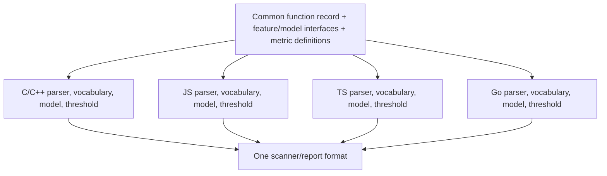

# VulnScope ML methodology

**Status:** Research protocol recorded 2026-10-13 before model training. The first Juliet subset has since been audited and run; see the [dataset audit](dataset-audit.md) and [phase reports](phases.md) for measured results and the declaration-leakage correction. This document complements the [architecture](architecture.md) and [resource inventory](resources.md).

## 1. Research findings that shape the design

- Code duplication can inflate evaluation results; [Allamanis (2019)](https://www.miltos.allamanis.com/publicationfiles/allamanis2019adverse/allamanis2019adverse.pdf) demonstrates this for models of source code. A [study of vulnerability datasets](https://ieeexplore.ieee.org/document/10172650/) also reports substantial duplicate and label-quality problems. This supports auditing examples before fitting any model.
- [PrimeVul research](https://arxiv.org/abs/2403.18624) uses deduplication and chronological evaluation because familiar benchmark splits can overstate real-world detection. For our project, a synthetic Juliet result and a real-world held-out result must be reported separately.
- [Grouped cross-validation guidance](https://scikit-learn.org/stable/modules/cross_validation.html) explains how to keep related groups together while approximating class balance. [Preprocessing guidance](https://scikit-learn.org/stable/common_pitfalls.html) says learned transforms must be fit only on training data.
- [Precision-recall guidance](https://scikit-learn.org/stable/auto_examples/model_selection/plot_precision_recall.html) recommends these measures for imbalanced classes and explains that threshold choice changes the precision/recall trade-off. [Calibration guidance](https://scikit-learn.org/stable/modules/calibration.html) motivates checking score reliability before calling a score a probability.

These sources motivate the protocol; their reported numbers are **not** expected results for VulnScope.

## 2. The exact prediction task

One example is one function and its surrounding metadata. The training target is binary: `1` when the audited dataset marks that function vulnerable, and `0` when its documented source marks it non-vulnerable or fixed. Keep the source's original label definition. Missing/uncertain labels are excluded from supervised training and counted in the audit, not silently mapped to `0`.

At inference, the model outputs a numeric score and a thresholded `flagged` or `not flagged` decision. The output is a review lead. A function-level label cannot justify an exact vulnerable-line highlight. CWE and line ranking require separate labels and evaluation.

## 3. Data processing in order

```mermaid
flowchart LR
    A[Acquire fixed release] --> B[Verify hash, license, schema]
    B --> C[Extract labelled functions + provenance]
    C --> D[Validate labels and source spans]
    D --> E[Find exact/near duplicates and related pairs]
    E --> F[Assign groups and freeze split manifest]
    F --> G[Fit vocabulary/scalers on training only]
    G --> H[Transform train, validation, test]
```

1. Preserve raw source and the file hash. Keep stable source IDs, dataset version, repository, commit, vulnerability ID, language, and license metadata.
2. Reject or quarantine missing code, invalid labels, parser failures, impossible source spans, and identical code carrying conflicting labels until reviewed. Record reasons and counts.
3. Give each labelled record a provisional source-based `group_id` on ingestion. Compute exact code hashes and conservative near-duplicate clusters. Treat vulnerable/fixed pairs, same commit, generated Juliet variants, and near-duplicate clusters as linked. Replace provisional IDs with a final `group_id` from their connected relationships before splitting so they cannot cross splits.
4. Keep metadata that reveals the label, such as CWE names, `bad`/`good` filenames, patch status, or source-dataset identifiers, **out of model features**. Inspect code comments and template markers for label leakage before deciding whether to strip them; document any removal.
5. Save immutable train/validation/test sample IDs and group IDs. Learned vocabulary, feature selection, scaling, class weights, and resampling use training data only.

## 4. Splits and generalization tests

| Set | Default share of retained labelled groups/samples | Permitted use |
|---|---:|---|
| Training | About 70% | Fit vocabulary, preprocessing, model weights, and any train-only class weighting |
| Validation | About 15% | Choose model size, regularization, epoch/checkpoint, ensemble weights, and decision threshold |
| Test | About 15% | One final estimate after choices are frozen; no redesign or threshold tuning against it |
| External / future | Separate source, unseen repositories, or later period | Measure transfer and drift; never merged into the internal test without an explicit new experiment |

The shares are **targets, not a reason to break groups**. Select complete groups first, then report actual sample counts and vulnerable prevalence in every split. Where feasible, approximately preserve class proportions with group-aware stratification, but never force exact balance by leaking a group. If too few independent positive/negative groups remain for all three sets, shrink the evaluation scope or use grouped cross-validation within training and explain the limit; do not publish unstable metrics as a reliable test.

For **Juliet**, use its `C/manifest.xml` flaw lines as candidate positive locations and map them to parsed function spans; do not infer a negative label merely from the absence of a flaw line. Audit safe counterparts separately. Hold out template/testcase families and related generated variants. Since it is synthetic, its internal test measures synthetic generalization only. For **real-world C/C++**, prefer unseen repositories; add a time-forward test where dates are trustworthy. For **JS/TS**, audit the release's existing temporal split, verify no pair or duplicate crosses it, and evaluate JS and TS separately. For **Go**, use repo/patch groups and a later or external test only after patch-derived labels pass audit. Do not claim one model transfers across languages merely because the feature vector has the same shape.

If a repository or timestamp constraint conflicts with class coverage, record the conflict and report the stricter evaluation and its uncertainty. Never silently fall back to a row-random test as the primary result.

## 5. Feature engineering: simple to structural

| Feature family | First experiment | Check for misleading shortcuts |
|---|---|---|
| Lexical | Language-aware tokens, selected unigrams/bigrams, operator and API-call counts; cap vocabulary using **training-only** frequency | Do not put paths, dataset IDs, CVE/CWE fields, or label-derived names into features. Inspect whether comments or synthetic markers expose labels. |
| Size/shape | Function length, parameter count, branch/loop/call counts, nesting depth | Report performance with and without size features; large functions may correlate with source labels without representing vulnerability. |
| AST | Node-type counts, depths, selected parent-child patterns, call and assignment structure | Parser error rate must be reported; use the same grammar and feature order in training and scanning. |
| Optional later | Defensible control/data-flow features | Add only with tests and an ablation; a parser alone does not provide data-flow reasoning. |

Keep raw tokens that may matter for security (API names, operators, literal kinds). A practical baseline is a capped bag-of-tokens vector plus a small number of numeric features. Fit token vocabulary and any scaling on training data only; unknown validation/test tokens map to an out-of-vocabulary behavior fixed before evaluation. Compare lexical-only, AST-only, and combined features on the **same** splits. Save vocabulary, scaling, feature order, and parser version with model weights.

## 6. Model construction and training

**Model A — custom logistic regression.** With features `x`, calculate `z = w·x + b`, then `sigmoid(z)` as the score. Optimize binary cross-entropy plus optional L2 penalty using a gradient and update loop we implement in NumPy. Use a numerically stable loss/sigmoid, fixed random seed, and numerical gradient checks on tiny fixtures. Compare zero/limited regularization on validation data.

**Model B — custom small MLP.** Use one hidden layer first: affine transform → ReLU → affine transform → sigmoid. Implement forward pass, weighted or unweighted binary cross-entropy, backpropagation, minibatch updates, and checkpoint restore ourselves. Begin with a small hidden width and grow it only when validation results justify it. Use L2 regularization and early stopping on validation loss, with a recorded patience and maximum epoch count. The [MLP documentation](https://scikit-learn.org/stable/modules/neural_networks_supervised.html) provides a reference for cross-entropy, gradients, and regularization; its classifier is **not** our core implementation.

**Overfitting checks.** Plot training and validation loss per epoch. A widening gap, falling training loss with worsening validation loss, or a large collapse on external repositories suggests overfitting or dataset shortcuts. Respond by auditing labels/duplicates/features first, then reducing vocabulary or network size, increasing L2, or stopping earlier. Each change is selected on validation data. Run multiple recorded seeds or grouped folds where compute and independent groups permit; report variability rather than only the best run.

## 7. Class imbalance and “balanced model”

The goal is **balanced performance**, not a forced 50/50 test set. Preserve the natural audited class ratio in validation, test, and external sets; report that ratio. An always-negative classifier can have high accuracy when vulnerable functions are rare, so accuracy is secondary.

Train an unweighted baseline first. If recall is poor because positives are scarce, compare a weighted cross-entropy loss using weights derived **only from the training split**. Tune the weight with validation data; do not apply oversampling before splitting. If train-only oversampling is later tried, keep duplicate or augmented examples inside their original training group and document the changed training prevalence. Weighting or resampling can distort score calibration, so inspect reliability on unmodified validation data.

## 8. Metrics and threshold policy

For the positive/vulnerable class:

- `precision = TP / (TP + FP)`: among flagged functions, the share labelled vulnerable;
- `recall = TP / (TP + FN)`: among labelled vulnerable functions, the share flagged;
- `F1 = 2 × precision × recall / (precision + recall)`: a summary of one chosen threshold;
- `false-positive rate = FP / (FP + TN)` and `false-negative rate = FN / (FN + TP)`;
- `PR-AUC / average precision`: ranking quality across thresholds, especially useful under imbalance;
- `ROC-AUC`, confusion matrix, support counts, class prevalence, and balanced accuracy as additional context.

Use a documented convention when a denominator is zero and never hide that case. Report **average precision (AP)** explicitly if using its stepwise definition; do not mix it with trapezoidal PR area as if they were identical. Check our metric implementation against hand-calculated fixtures and an established reference implementation during development.

Before touching the test set, choose a threshold policy from the validation precision-recall curve that fits the intended review workload. Record the selected threshold, its validation precision/recall, and how many findings per scanned functions it produces. Report several validation operating points if no single policy is obvious; select one primary policy before final testing. Do not choose a threshold from test data. For a displayed probability rather than a generic score, inspect calibration curves and Brier/log-loss on held-out data; do not claim that `0.8` means an 80% real-world vulnerability chance without support.

## 9. Three-language support

This is **one product with language-specific trained bundles**. C and C++ may share a model only if per-language validation supports it; likewise JS and TS. The scanner routes by detected language and rejects a bundle trained for another language or feature version. No language is marked supported until its own data audit, split, evaluation, and artifact load test pass. A shared or transfer model is a later experiment compared against these per-language baselines.

## 10. Experiment record and stopping rule

Every run stores dataset hashes, split IDs, label counts, group rule, parser/version, feature definition, vocabulary hash, model code version, seed, hyperparameters, epoch history, threshold policy, per-language metrics, and artifact hash. Keep a small experiment table that includes unsuccessful runs. After an experiment's model and threshold are selected, run the untouched test once and write the result as a frozen report; if design changes afterward, create a new named experiment with a new untouched evaluation source rather than treating the same test as fresh.

The project does not require a promised score. A defensible result can show that a custom model works on a controlled benchmark but does not transfer well to real repositories. That result still answers the research question and prevents misleading scanner claims.
